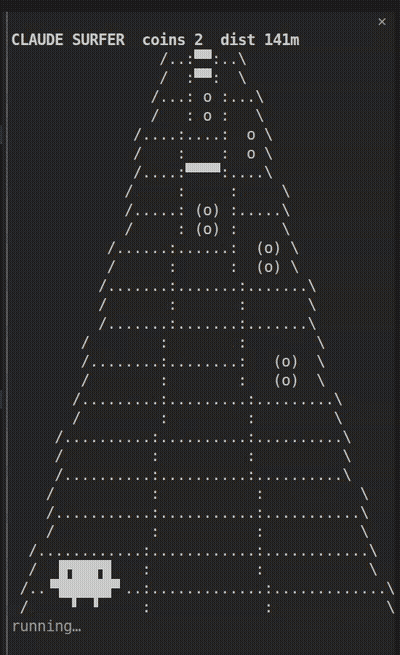

# claude-surfer

Your attention span is cooked and Claude is thinking for like 40 whole seconds. Unacceptable. This plugin pops open a pane and Claude plays Subway Surfers in ASCII so you don't have to stare at a spinner without stimulation. Peak productivity.



## Install

```
/plugin marketplace add daanvangeloven/claude-surfer
/plugin install claude-surfer
```

## Use

- Send a prompt. If the turn runs longer than 15 seconds, the pane opens by itself.
- It closes when the turn ends.
- `/surfer` toggles "open right away on every prompt" instead of waiting for a long turn.

You don't play. Claude does. You watch.
